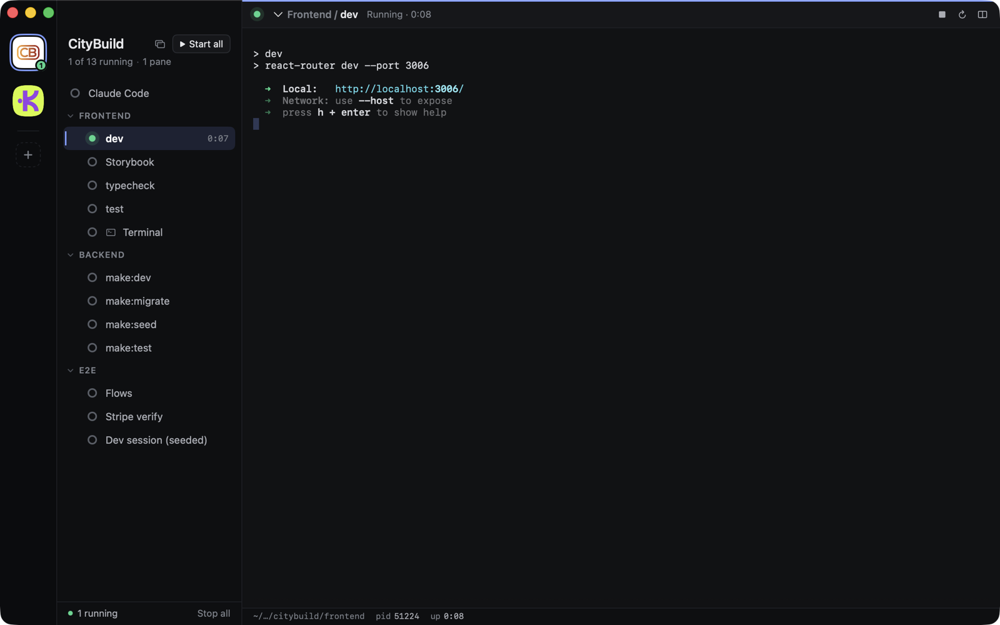
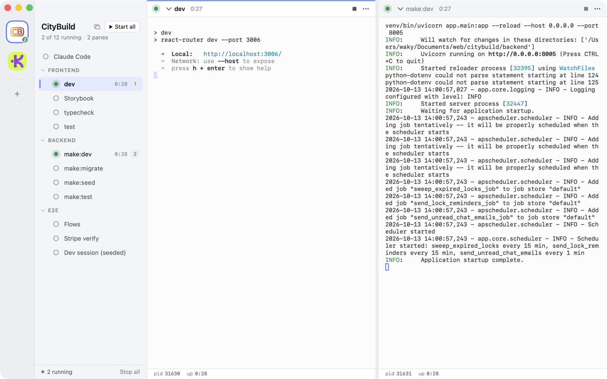
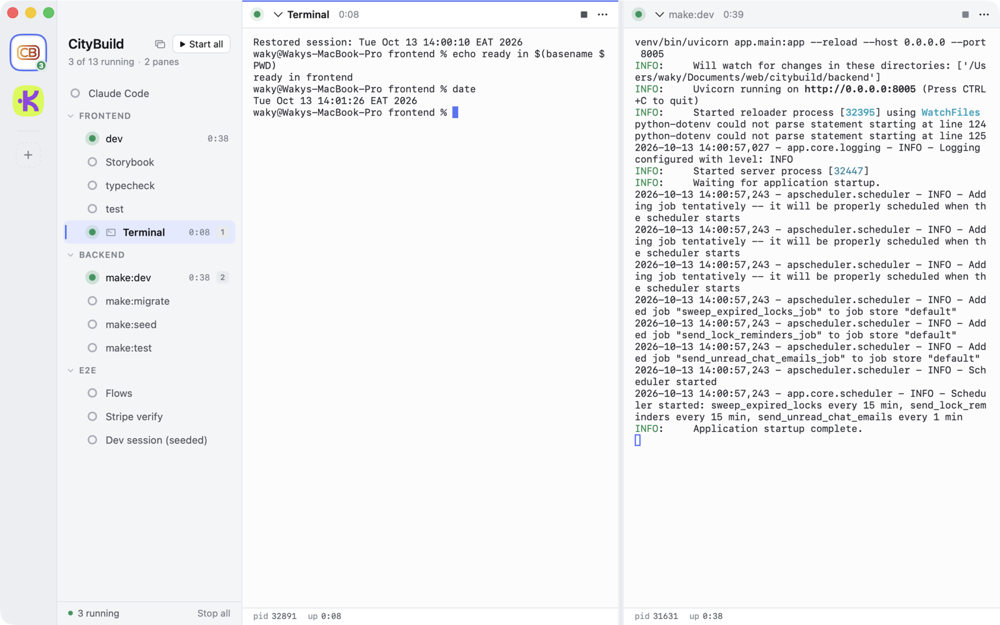
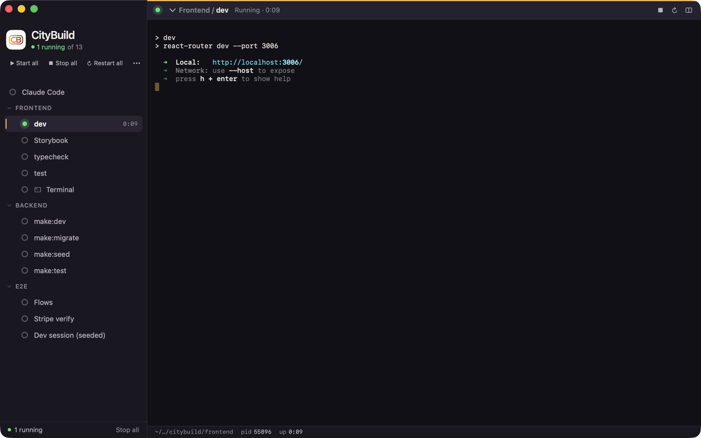

# Switchboard

A native Mac app that starts, watches and stops a project's dev commands from one window.
A project is a logical group of commands, not a directory, so one project can span your
API, web app and e2e repos, with each command running in its own folder.

https://github.com/user-attachments/assets/f5857738-879c-42da-b913-c22b9c89c70e

**[Watch the 73-second narrated walkthrough](docs/media/walkthrough.mp4)**
([subtitles](docs/media/walkthrough.srt))

## What it does

- **One click starts a project.** Every command runs in a real terminal, with a status
  marker for running, done, crashed and missing folders, and crash restarts with backoff.
- **Split panes.** Up to four terminals in a window. Drag a command onto a pane edge to
  split, or onto the centre to replace.
- **Terminals on demand.** ⌘T opens a shell in a group's folder and it is still there next
  launch.
- **A window per project.** Pull a project off the main board into its own window, with its
  own theme.
- **Live links.** ⌘-click plain URLs, Markdown links and terminal hyperlinks.
- **Themes.** Three built-in themes in light and dark, plus per-project custom palettes.
- **Arrange it your way.** Drag to reorder projects, groups and commands. Groups get an
  icon from context, or pick one.
- **Coming from Solo?** Drop a folder with a `solo.yml` and it is converted.
- **Config you can version.** YAML on disk, live-reloaded, and optionally kept in your
  repos so a new machine is one drop away.
- **Nothing left behind.** Stop and Quit take down whole process groups.
- **Agents can drive it.** The `switchboard` command starts, waits on and reads your
  commands in the app. A bundled skill teaches coding agents to use it.

| | |
|---|---|
|  |  |
|  |  |

## Install

Download `Switchboard-<version>.zip` from the
[latest release](https://github.com/jestrux/switchboard/releases/latest), unzip it and drag
Switchboard to Applications. It is signed and notarized, and needs macOS 14 or later.

## Build from source

Requires macOS 14+, Xcode 15+, a Rust toolchain and [xcodegen](https://github.com/yonaskolb/XcodeGen).

```sh
scripts/package.sh        # build, install to /Applications, launch
```

Then drop a folder containing `config.yaml` onto the sidebar, or use File › Install Sample
Project. [`samples/`](samples) has two real ones to read.

A minimal project:

```yaml
version: 1
name: Acme
groups:
  - id: web
    cwd: ~/code/acme-web
    commands:
      - { id: dev, run: npm run dev }
  - id: api
    cwd: ~/code/acme-api
    commands:
      - { id: dev, run: make dev, restart_on_crash: true }
      - { id: migrate, run: make migrate, autostart: false }
```

## Docs

- **[Feature list](docs/features/README.md)**: everything the app does, by area, with how
  to reach each feature and its limits.

- **[Projects, config and repo files](docs/projects.md)**: the config format, keeping
  settings in your repos with `.switchboard/`, terminals, the `switchboard` command and the agent skill.
- **[Setting up a project](docs/setting-up-a-project.md)**: a checklist for taking a
  product folder to a themed, verified project, including converting from Solo.
- **[Theming](docs/theming.md)**: built-in themes, per-project themes and custom palettes,
  with screenshots of each.
- **[Agent guide](docs/agent-guide.md)**: how to build, test and iterate on this codebase
  quickly. Start here if you are an AI agent or new to the repo.
- [`PLAN.md`](PLAN.md): what is left to build.

`scripts/docs.sh` opens all of these as a searchable site in the browser.
- [`handoff/PRD.md`](handoff/PRD.md): the original product spec.

## Layout

```
crates/sb-core      Rust engine: config, supervisor, PTY sessions, file watcher
crates/sb-cli       `switchboard` command-line front end
crates/sb-ffi       UniFFI bridge used by the Mac app
app/                SwiftUI app
samples/            Reference projects (Kinpay, CityBuild)
scripts/            Build, package, walkthrough and screenshot scripts
docs/               Feature list, guides and media (Markdown is the source)
docs-site/          Browser viewer for docs/
```
