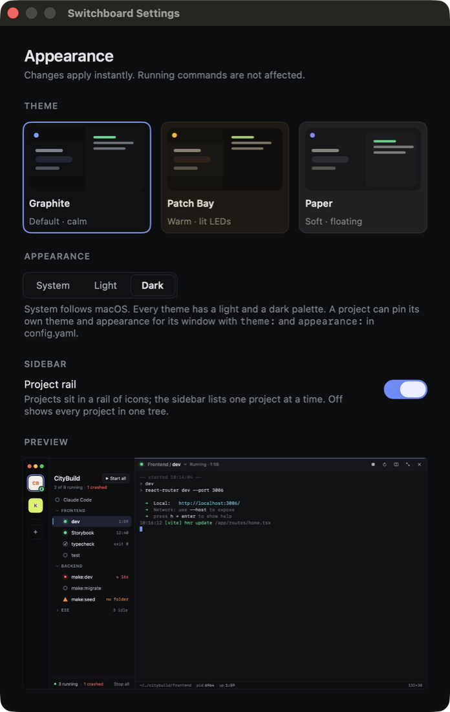
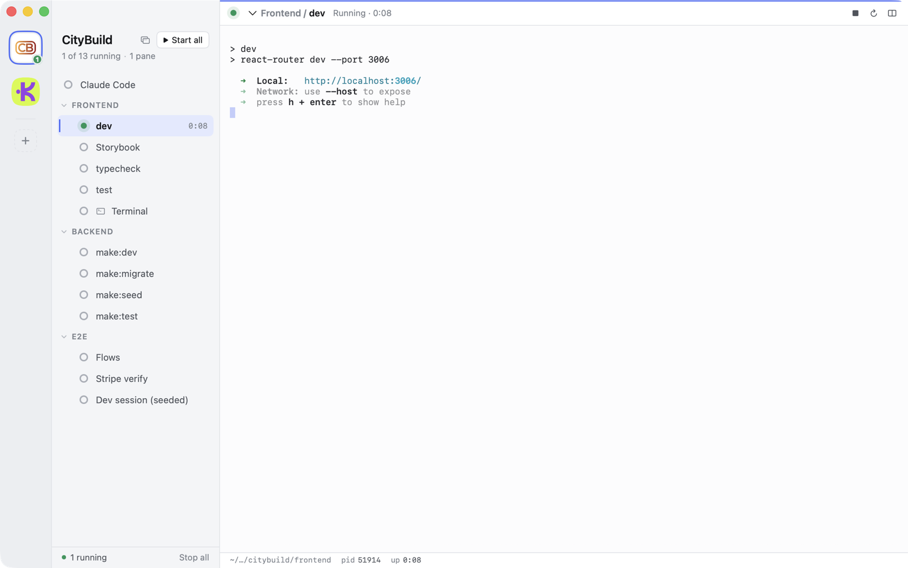
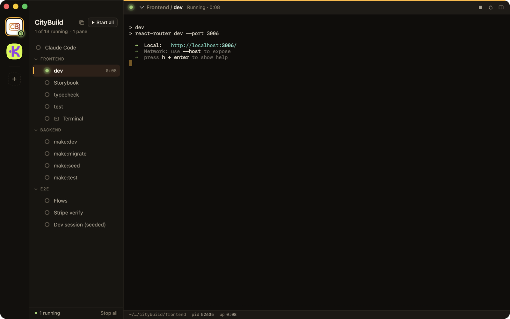
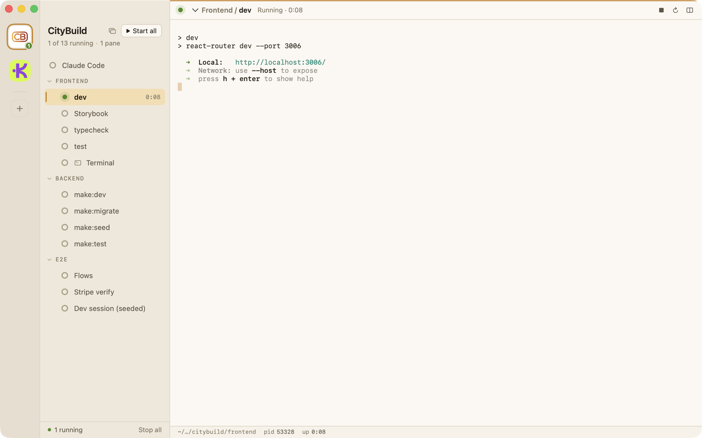
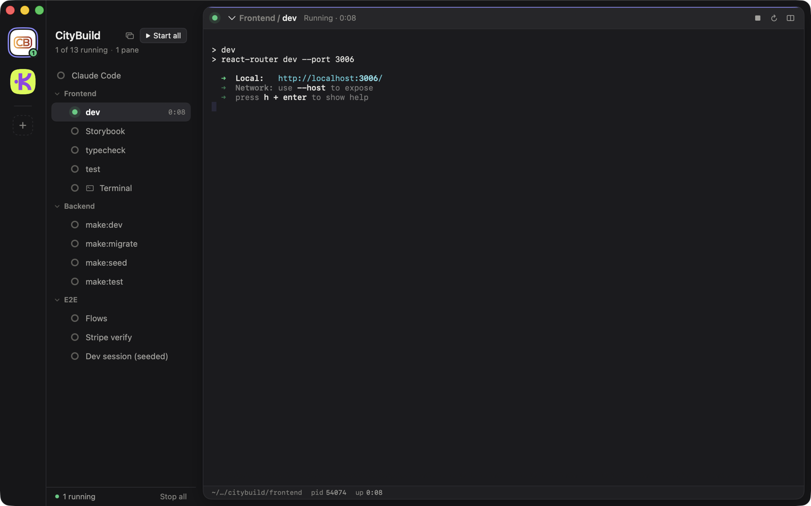
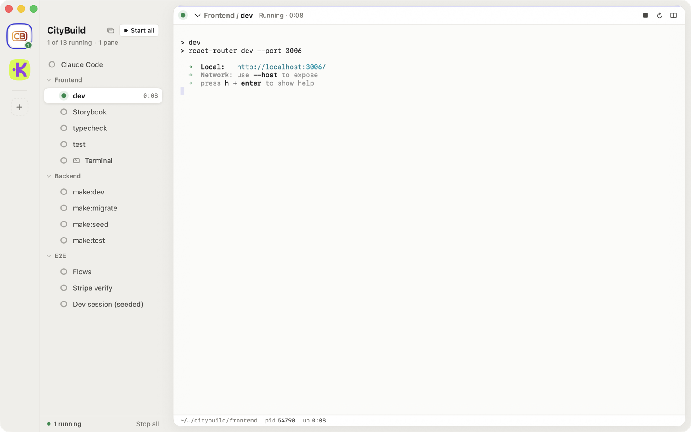
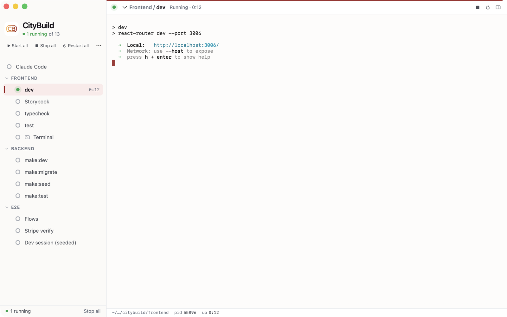
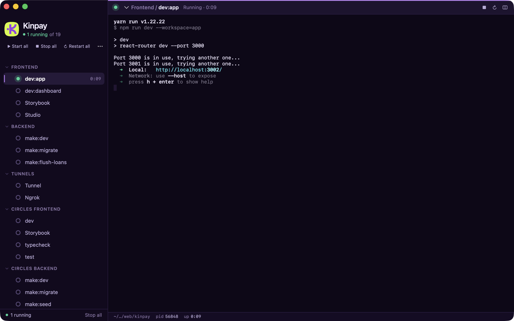
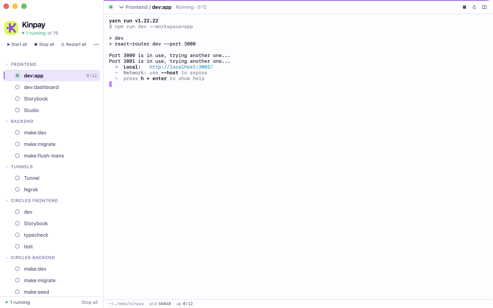

# Theming

Switchboard has three built-in themes, each with a light and a dark palette, and lets a
project bring its own colours for its own window.

- [Choosing a theme](#choosing-a-theme)
- [Built-in themes](#built-in-themes)
- [Per-project themes](#per-project-themes)
- [Custom themes](#custom-themes)
- [Token reference](#token-reference)

## Choosing a theme

Settings (⌘,) has two independent controls. **Theme** picks Graphite, Patch Bay or Paper.
**Appearance** picks System, Light or Dark. System is the default and follows macOS, and
every theme has both palettes, so nothing is dark-only or light-only. The preview under
the controls updates as you change them.



## Built-in themes

### Graphite

The default. Calm and neutral, with an accent bar on the selected row.

| Dark | Light |
|---|---|
|  |  |

### Patch Bay

Warm hardware tones with monospaced group labels. In dark mode, status markers glow like
lit LEDs.

| Dark | Light |
|---|---|
|  |  |

### Paper

Soft and floating. The pane sits on the window as a rounded card, group labels are
sentence case, and the selected row is a white card.

| Dark | Light |
|---|---|
|  |  |

## Per-project themes

A project can pin its own look in `config.yaml`. It applies when the project is open in
**its own window** (right-click the project › Open in New Window). The main board keeps
the app-wide setting, so one project can be dark Patch Bay while the board follows the
system in Graphite.

```yaml
theme: patch-bay        # graphite · patch-bay · paper
appearance: dark        # system · light · dark
```

Leave `appearance` out, or set it to `system`, and the project's window follows macOS.

## Custom themes

`theme:` also accepts a block: a `base` built-in to inherit from, plus `dark:` and
`light:` maps that override individual colour tokens. Anything you leave out comes from
the base, so a custom theme can be two lines or a full palette. Define both maps and the
theme stays system-aware.

```yaml
theme:
  name: CityBuild
  base: graphite              # inherits layout style and any token you don't set
  dark:
    window: "#141118"
    accent: "#F7AD3F"
    running: "#4ADE80"
    ansi: ["#2B2830", "#C4393C", "#4ADE80", "#F7AD3F", "#7FA7D9", "#C792EA", "#5FD7E8", "#D6D2D8",
           "#4E4A56", "#E85C5F", "#6EE7A0", "#FFC56B", "#A3C2E8", "#DDB3F5", "#8AE6F2", "#FFFFFF"]
  light:
    window: "#F7F5F2"
    accent: "#981C1E"
appearance: system
```

Values must be `"#RRGGBB"`. Unknown tokens, bad colours and an `ansi` list that isn't 16
entries are reported as config errors, in the sidebar and by `sb validate`.

The two sample projects carry full palettes taken from their products' own CSS variables.

### CityBuild

From the marketing site's ink background with crimson and gold: gold accents in dark,
crimson in light. See [`samples/citybuild/config.yaml`](../samples/citybuild/config.yaml).

| Dark | Light |
|---|---|
|  |  |

### Kinpay

From the app and dashboard's purple system: lilac on deep violet in dark, purple on
near-white in light. See [`samples/kinpay/config.yaml`](../samples/kinpay/config.yaml).

| Dark | Light |
|---|---|
|  |  |

## Token reference

| Group | Tokens |
|---|---|
| Surfaces | `window` `rail` `sidebar` `pane` `header` `line` `hover` `button` `buttonLine` |
| Terminal | `terminal` `terminalText` `terminalDim` `ansi` (16 colours: 0–7 normal, 8–15 bright) |
| Text | `text` `text2` `text3` `text4` |
| Selection and accent | `selection` `selectionText` `accent` `onAccent` `accentSoft` `accentSoftText` |
| Status | `running` `starting` `crashed` `error` `stopped`, each with a `…Soft` background |

The built-in values are in [`app/Switchboard/Theme.swift`](../app/Switchboard/Theme.swift).
A theme changes colour only. Layout details such as Paper's floating pane come from the
`base` you choose.

The screenshots on this page are produced by `scripts/walkthrough/theme_shots.py`.
